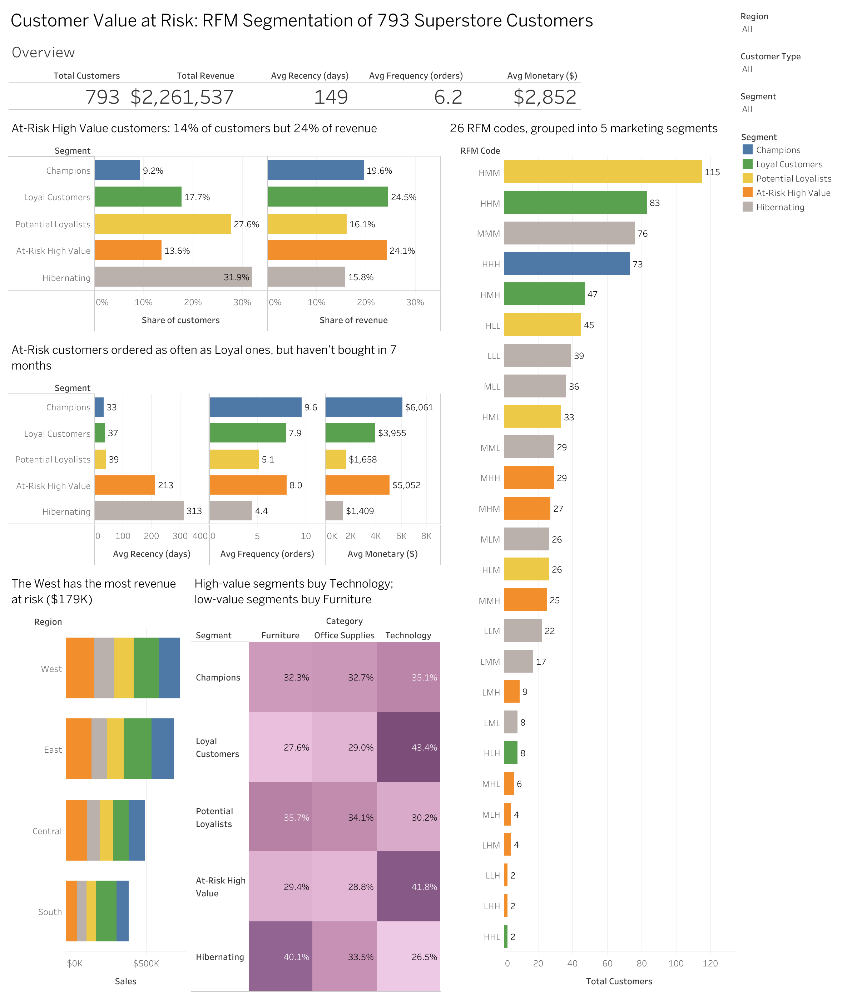

# Customer Value at Risk: RFM Segmentation of Superstore Customers

**Which customers drive revenue, which ones are slipping away, and where should marketing spend its next dollar?**

I segmented 793 customers of an office-supply retailer by **Recency, Frequency and Monetary value (RFM)** in Python, grouped them into 5 marketing segments, and built an interactive Tableau dashboard for senior management.

**[View the interactive dashboard on Tableau Public →](https://public.tableau.com/app/profile/meng.wen.han/viz/CustomerValueatRisk-SuperstoreRFMSegmentation/RFMDashboard)**



## Key findings

- **$546K of revenue is at risk.** *At-Risk High Value* customers are only **14% of customers but 24% of revenue**, about as much as Loyal Customers bring in.
- **They are lapsed loyalists, not low-value buyers.** They ordered as often as Loyal Customers (8.0 vs 7.9 orders) and spent more ($5,052 vs $3,955). The only difference: they haven't bought in **7 months** on average (213 days vs 38).
- **The West has the most revenue at risk ($179K).** Central has the highest *share* of at-risk revenue (26.7%), but the West has the most *dollars* at stake, so it's the better place to start a regional win-back push.
- **High-value segments buy Technology.** Technology is 42–43% of spend for Loyal and At-Risk customers, compared with 27% for Hibernating customers, who lean toward Furniture.
- **Revenue is concentrated, but not 80/20.** The top 25% of spenders generate **55.5%** of revenue, so growing the middle tier matters as well as protecting the top.

## Recommendations

| Segment | Customers | Revenue share | Recommended action |
|---|---|---|---|
| **Champions** | 73 (9%) | 20% | VIP program, early access to new products, referral incentives |
| **Loyal Customers** | 140 (18%) | 24% | Loyalty rewards and Technology upgrade offers to protect frequency |
| **Potential Loyalists** | 219 (28%) | 16% | Cross-sell Technology to customers who mostly buy Furniture and Office Supplies |
| **At-Risk High Value** | 108 (14%) | 24% | **Top priority:** personal win-back outreach with Technology incentives, starting in the West |
| **Hibernating** | 253 (32%) | 16% | Low-cost automated email reactivation; don't spend heavily |

**Why At-Risk first:** it's a small list (108 people), they already know the brand, and each is worth about $5,000. Winning back even a third of them would protect roughly $180K in revenue.

## Approach

### 1. Data preparation
- **Data:** 9,800 order lines (4,922 orders) from Jan 2015 to Dec 2018, with region, customer type and product category.
- Parsed dates as **day/month/year** (the source format) and confirmed it with a sanity check: no order ships before it's placed.
- Checked for duplicates (none) and missing values (11 missing postal codes, all for Burlington, Vermont; not used in the analysis).

### 2. Calculating R, F and M per customer
- **Recency:** days since the customer's last order, measured from **Dec 31, 2018** (the day after the last order in the data).
- **Frequency:** number of **unique orders**.
- **Monetary:** total sales.

### 3. Setting thresholds

| Score | High (H) | Medium (M) | Low (L) | Method |
|---|---|---|---|---|
| **R** | ≤ 90 days | 91–365 days | > 365 days | Calendar cutoffs |
| **F** | 8+ orders | 5–7 orders | 1–4 orders | Quartiles |
| **M** | $3,670+ | $1,081–$3,669 | < $1,081 | Quartiles |

- **Recency uses calendar cutoffs** that marketers already think in: "bought this quarter" and "not in a year". Quartile cutoffs (31 and 185 days) have no business meaning and would shift every time the data is refreshed.
- **Frequency and Monetary use quartiles** (bottom 25% / middle 50% / top 25%) because both are skewed and have no natural business breakpoints. Monetary is strongly right-skewed (skew 2.5), so the median, not the mean, describes the typical customer.

### 4. From 26 RFM codes to 5 segments
Combining the three scores produced 26 RFM codes (LHL never occurs). I grouped them with rules that put **every customer into exactly one segment**:

| Segment | Rule |
|---|---|
| Champions | HHH |
| Loyal Customers | Recent (R = H) and high frequency or high spend |
| Potential Loyalists | Recent, but medium/low frequency and spend |
| At-Risk High Value | Not recent (R = M or L), but high frequency or high spend |
| Hibernating | Not recent, and medium/low frequency and spend |

### 5. Dashboard
- Exported a **customer-level** table (one row per customer) and a **transaction-level** table (one row per order line) from Python.
- Connected them in Tableau with a one-to-many **relationship** on Customer ID, so customer averages and regional revenue are each calculated at the right level.
- Filters for Region, Customer Type and Segment apply to every chart.

## What I fixed from the original coursework

This project began as an NYU assignment (*Data-Driven Decision Making*, MASY 1215) built in RapidMiner and Tableau. Rebuilding it in Python surfaced four problems in the original:

1. **Frequency counted product lines, not orders.** One order with three products counted as three purchases, so average frequency was **12.4 instead of 6.2**: double the real number.
2. **Recency was measured from today's date** instead of the end of the data. Every customer showed 2,500+ days since their last purchase, and the values grew every time the analysis was re-run.
3. **The 80/20 claim was assumed, not tested.** The original stated that the top 25% of customers "likely" drive 70–80% of revenue. Measured, it's 55.5%.
4. **The revenue KPI broke under filtering.** In the first version of the dashboard, filtering to the West showed $2.07M, the lifetime spend of every customer who had *ever* ordered in the West. Switching the KPI to transaction-level sales gives the correct **$710K**.

I also added analysis the assignment asked for but the original didn't cover: **revenue share per segment** and **what each segment buys**.

## Limitations

- **Customers buy across regions.** 765 of 793 customers ordered in more than one region, so regional results describe *where revenue happens*, not where customers live.
- **Correlation, not causation.** High-value customers buy more Technology partly because Technology items cost more. This doesn't mean selling Technology *creates* loyal customers.
- **No profit data.** Segments are based on revenue; a margin view could change which segments are most worth the marketing spend.

## Repository structure

```
├── analysis.ipynb          # Data cleaning, RFM scoring, segmentation, analysis
├── rfm_dashboard.twbx      # Tableau packaged workbook (includes data)
├── data/
│   └── superstore_sales.csv
├── output/
│   ├── customers_rfm.csv   # One row per customer, with R/F/M scores and segment
│   └── transactions.csv    # One row per order line, for regional and category views
└── figures/
    └── dashboard.png
```

## How to run

```bash
pip install pandas matplotlib jupyter
jupyter notebook analysis.ipynb
```

Open `rfm_dashboard.twbx` in Tableau Desktop or Tableau Public (free).

## Data source

*Superstore Sales* dataset (`train.csv`), publicly available on Kaggle.

---

**Avery Han (Meng Wen Han)** · M.S. Management & Analytics, NYU · [LinkedIn](https://www.linkedin.com/in/meng-wen-han)

**Tools:** Python · pandas · matplotlib · Jupyter · Tableau
